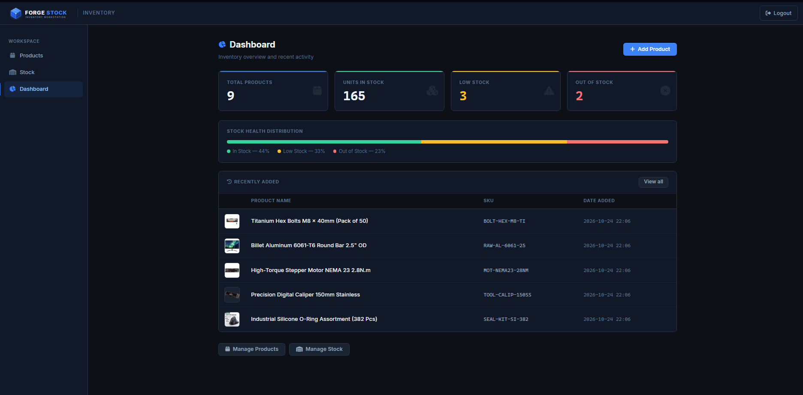
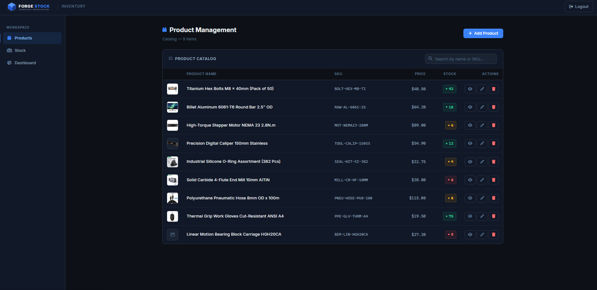
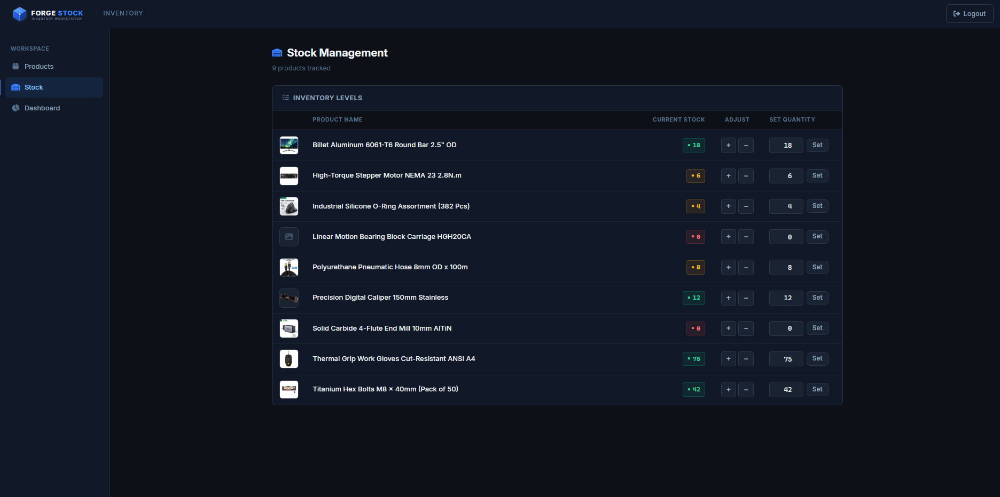
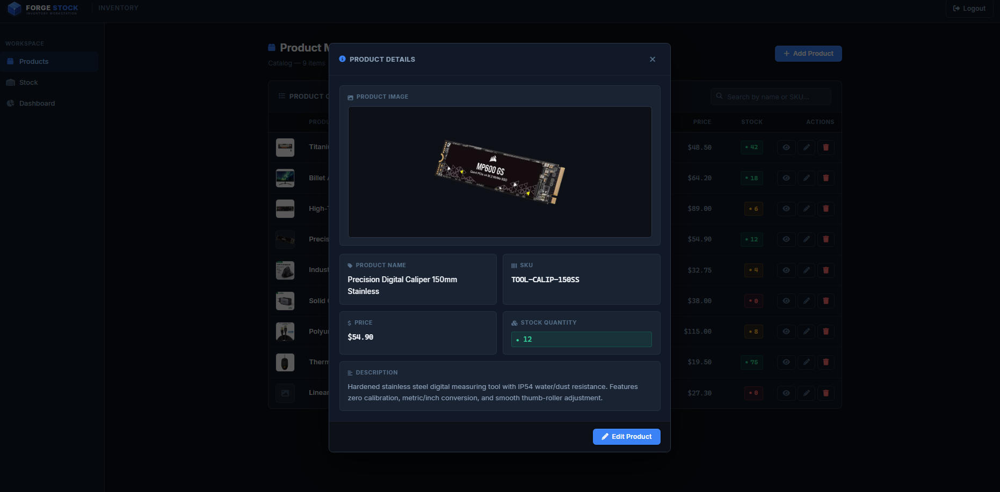
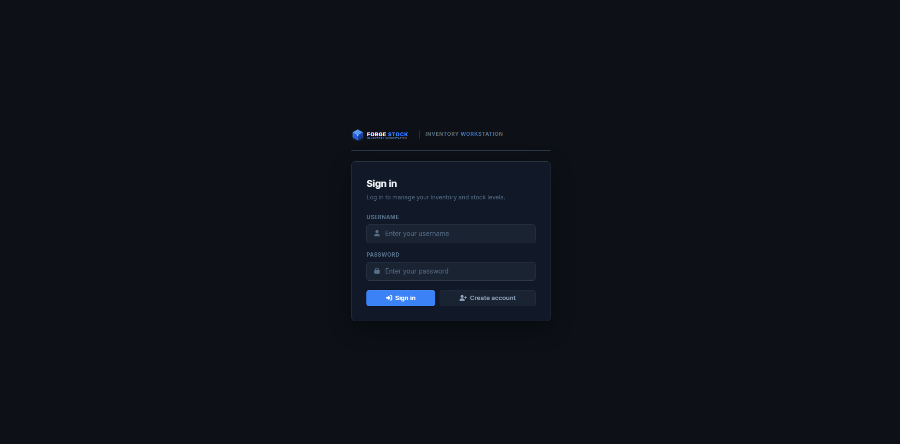

# ForgeStock • Modern Materials & Inventory Management Workstation

<p align="center">
  
  
  
  
  
</p>

A lightweight, production-grade inventory and internal materials management system built for fabrication shops, engineering labs, and hardware startups. Features real-time stock triage, high-density component ledgers, asynchronous stock counting steppers, monospaced tabular numerals, and a precision dark theme.

---

## Preview & Screenshots

<p align="center">
  
</p>

<details open>
  <summary><b>Click to expand more views</b></summary>
  <br/>

  <table width="100%">
    <tr>
      <th width="50%" align="center">Product Catalog &amp; Registry</th>
      <th width="50%" align="center">Stock Management Workbench</th>
    </tr>
    <tr>
      <td width="50%" align="center">
        
      </td>
      <td width="50%" align="center">
        
      </td>
    </tr>
    <tr>
      <th width="50%" align="center">Component Detail Modal</th>
      <th width="50%" align="center">Authentication &amp; Onboarding</th>
    </tr>
    <tr>
      <td width="50%" align="center">
        
      </td>
      <td width="50%" align="center">
        
      </td>
    </tr>
  </table>

</details>

---

## Key Features

- **Executive Operations Dashboard:** Real-time KPI counters (`Total Products`, `Gross Units in Stock`, `Low Stock`, `Out of Stock`), proportional multi-segment health distribution track, and chronological activity feed of recently cataloged items.
- **High-Density Inventory Ledger:** Compact 44px vertical row rhythm, 38px part thumbnails, right-aligned currency figures, and monospaced tabular numerals (`tabular-nums`) for instant vertical scanability across large part catalogs.
- **Tri-State Semantic Stock Indicators:** Real-time micro-chip status indicators with color-coded pips:
  - 🟢 **In Stock:** Ample operating stock.
  - 🟡 **Low Stock (< 10):** Warning threshold highlighting items due for replenishment.
  - 🔴 **Out of Stock (0):** Depleted items flagged for immediate reordering.
- **Asynchronous Rapid Stock Control:** Tactile stepper controls (`+` / `−`) and direct numerical input that update inventory via asynchronous background `fetch()` requests without page reloads or layout shift.
- **Component Inspection Modal:** Deep component view drawer with full-resolution part imagery, SKU, unit pricing, real-time stock chip, and direct routing to edit mode.
- **Zero-Dependency Architecture:** Pure native PHP 8+ and vanilla JavaScript with zero Node.js build pipelines, external client frameworks, or bundle bloat.
- **Industrial Workstation Design System:** Obsidian canvas (`#0d1117`), structured charcoal surfaces (`#111827`), hairline borders, and purposeful cobalt accents (`#3b82f6`) calibrated for zero eye fatigue.

---

## Tech Stack

- **Backend:** [Native PHP 8.x](https://www.php.net/) (Session-based authentication, MySQLi prepared statements)
- **Frontend:** Vanilla JavaScript (ES6+, Fetch API, DOM manipulation, zero npm dependencies)
- **Styling:** Custom CSS3 Design System with CSS Custom Properties (`index.css`, `product_management.css`, `login.css`)
- **Database:** [MySQL / MariaDB](https://www.mysql.com/) with relational indexing and foreign-key ready schema
- **Runtime Environment:** [Apache 2.4+](https://httpd.apache.org/) via [XAMPP](https://www.apachefriends.org/)

---

## Quick Start

### 1. Place in XAMPP Web Root

Clone or copy the project directory to your local XAMPP web root:

```bash
# Target directory
C:\xampp\htdocs\mit
```

### 2. Start Services

Open the **XAMPP Control Panel** and start **Apache** and **MySQL**.

### 3. Initialize Database & Tables

Open **phpMyAdmin** at [http://localhost/phpmyadmin](http://localhost/phpmyadmin) or run via MySQL CLI:

```sql
CREATE DATABASE IF NOT EXISTS nativ_php_app_vf CHARACTER SET utf8mb4 COLLATE utf8mb4_unicode_ci;
USE nativ_php_app_vf;

CREATE TABLE IF NOT EXISTS users (
    id INT AUTO_INCREMENT PRIMARY KEY,
    username VARCHAR(100) NOT NULL UNIQUE,
    email VARCHAR(255) NOT NULL,
    password_hash VARCHAR(255) NOT NULL,
    created_at TIMESTAMP DEFAULT CURRENT_TIMESTAMP
);

CREATE TABLE IF NOT EXISTS products (
    id INT AUTO_INCREMENT PRIMARY KEY,
    product_name VARCHAR(255) NOT NULL,
    sku VARCHAR(100) NOT NULL UNIQUE,
    price DECIMAL(10,2) NOT NULL DEFAULT 0.00,
    stock INT NOT NULL DEFAULT 0,
    description TEXT,
    image_path VARCHAR(255),
    created_at TIMESTAMP DEFAULT CURRENT_TIMESTAMP
);
```

### 4. Seed Realistic Sample Inventory

Populate 9 realistic industrial items across all stock states (In Stock, Low Stock, Depleted):

```bash
# Run from within C:\xampp\htdocs\mit
C:\xampp\php\php.exe seed_products.php
```

### 5. Access Application

Open your browser and navigate to:

```text
http://localhost/mit/login.php
```

Register a new account or sign in with existing credentials to access the dashboard.

---

## Sample Inventory Dataset

The bundled `seed_products.php` utility seeds the following demonstration hardware:

| SKU | Product Name | Unit Price | Initial Stock | Health Status |
| :--- | :--- | :---: | :---: | :---: |
| `BOLT-HEX-M8-TI` | Titanium Hex Bolts M8 x 40mm (Pack of 50) | $48.50 | 42 | 🟢 In Stock |
| `RAW-AL-6061-25` | Billet Aluminum 6061-T6 Round Bar 2.5" OD | $64.20 | 18 | 🟢 In Stock |
| `TOOL-CALIP-150SS` | Precision Digital Caliper 150mm Stainless | $54.90 | 12 | 🟢 In Stock |
| `PPE-GLV-THRM-A4` | Thermal Grip Work Gloves ANSI A4 | $19.50 | 75 | 🟢 In Stock |
| `MOT-NEMA23-28NM` | High-Torque Stepper Motor NEMA 23 2.8N.m | $89.00 | 6 | 🟡 Low Stock |
| `SEAL-KIT-SI-382` | Industrial Silicone O-Ring Kit (382 Pcs) | $32.75 | 4 | 🟡 Low Stock |
| `PNEU-HOSE-PU8-100` | Polyurethane Pneumatic Hose 8mm x 100m | $115.00 | 8 | 🟡 Low Stock |
| `MILL-CR-4F-10MM` | Solid Carbide 4-Flute End Mill 10mm AlTiN | $38.00 | 0 | 🔴 Out of Stock |
| `BER-LIN-HGH20CA` | Linear Bearing Block Carriage HGH20CA | $27.30 | 0 | 🔴 Out of Stock |

---

## Project Structure

```
mit/
├── assets/
│   ├── index.css                 # Base design tokens, layout shell & navigation
│   ├── product_management.css    # High-density tables, steppers, badges, modal
│   ├── login.css                 # Obsidian authentication card & transitions
│   ├── screenshots/              # Application screenshots for documentation
│   ├── logo.svg                  # High-contrast vector branding mark (ForgeStock)
│   └── product1.jpg              # Default fallback image asset
├── uploads/
│   └── products/                 # Upload directory for dynamic product imagery
├── add_product.php               # POST handler for product creation & image upload
├── config.php                    # Database configuration & MySQLi connection
├── delete_product.php            # POST handler for part removal & file unlinking
├── index.php                     # Executive overview & operational KPI dashboard
├── login.php                     # Sign in / registration interface
├── logout.php                    # Session termination & redirect
├── product_management.php        # Master product catalog ledger & inspection modal
├── register.php                  # POST handler for user account registration
├── seed_products.php             # CLI seeder for realistic industrial inventory
├── stock_management.php          # Real-time stock counting workstation
└── update_stock.php              # Async JSON endpoint for stock stepper mutations
```

---

## License

This project is open-source software licensed under the [MIT License](LICENSE).
